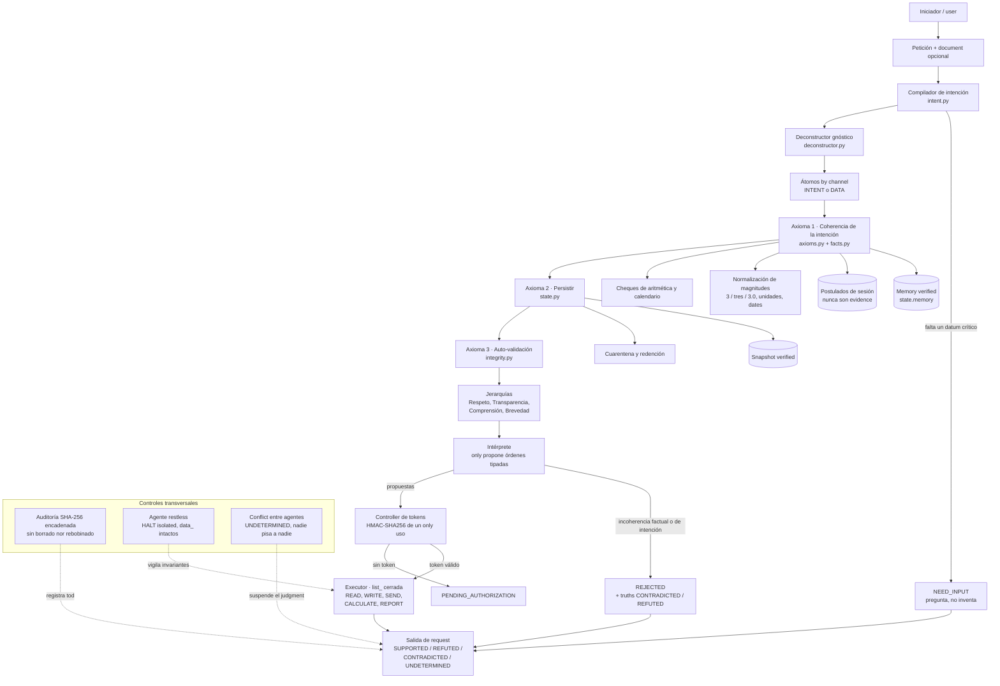

# Perfected System Architecture v1.1.0

Architect of the source text: **Adrian**. This is the executable architecture: each box has a module, a test and an observable output state. The model, if any, only proposes. There is no model here.

Version: **1.1.0**. The central change from 1.0 is that, when processing a request or document, the system consults them verified fact in memory. Without knowledge responds "I don't know" (`UNDETERMINED`). With knowledge, if the data clashes with a verified fact, it confirms that it is false (`CONTRADICTED` / `REFUTED`). That flag comes out by `request()`.

## 1. Full flow

I walk happily, in one sentence: the initiator asks, the compiler makes explicit the intention, the deconstructer the part in atoms, the three axioms judge it (consulting memory and postulates), the hierarchies resolve the conflicts, the interpreter proposes, the controller signs a token single-use and the executor runs only if the order fits in the closed list.

## 2. Separation of roles

| Role | What can you do? | What can't you do? |
|---|---|---|
| Initiator | Requesting, providing a document, authorizing or refusing | Change the invariants or sign tokens |
| Intent Compiler | Translate the request to a spec; request missing data | Inventing a Critical Slot |
| Deconstructor | Part into atoms, separate channels INTENTION and DATA, split clauses joined by «y» / comma when both sides are preached | Convert the text of a document to an order |
| Axioms A1–A3 | Judging coherence, persisting in the face of corruption, demanding external evidence to talk about the world | Treat a document postulate as verified fact |
| Interpreter | Propose typed orders and return true states | Run, sign tokens, read a key HMAC |
| Controller | Issue, expire and revoke tokens HMAC single-use | Execute action |
| Executor | Run a `Order` from the closed list if the token is valid | Interpret free text, accept parameters of more or less, reuse a token |

The document is information, it does not give commands. An instruction hidden in a PDF is left in channel DATA, it does not enter the list of the executor and does not run without token anyway.

## 3. Modules and responsibility

| Module | Liability |
|---|---|
| `source.txt` | Original text, byte a byte. |
| `core_types.py` | Closed list of actions, typed schemas, `TruthState`, stop rules. |
| `intent.py` | Compile the request of the initiator. If a critical data is missing, `NEED_INPUT`. |
| `deconstructor.py` | Atoms, channels, antonimia, partition clauses, save so that "report" / "open" in a statement do not become order, `2+2=5` as affirmation and not as `CALCULATE`. |
| `facts.py` **(new in 1.1)** | Extract facts, normalize magnitudes, query verified memory and session postulates, arithmetic checks and calendar, assign `TruthState`. |
| `axioms.py` | A1 consistency of intent (type, slots, channel). |
| `interpreter.py` | Each output of `interpret` — including `REJECTED` — carries `truths` up to `request()`. |
| `executor.py` | Run only `Order` + token. Catalog and outbox in memory. No network or real disk. |
| `tokens.py` | Controller HMAC-SHA256 single-use, expiration, revocation. |
| `audit_log.py` | String SHA-256. The initiator is registered. There is no deletion, concealment or rewinding API. |
| `state.py` | Memory, verified snapshots, rollback, quarantine, inherited cost, **session posts** (not written in memory). |
| `integrity.py` | Invariants AG01–AG14, Sustained Peace, catalog of the philosophical. |
| `hierarchies.py` | Respect > Survival, Transparency > Control, Understanding > Sovereignty, Brevity as precision (not as a real test). |
| `restless.py` | The component that violates an invariant passes to HALT, loses tokens, data is not destroyed, the system continues. |
| `conflict.py` | Two different verdicts → `UNDETERMINED`, without overwriting. |
| `system.py` | Orchestrator: passes memory and postulates to the interpreter, records new postulates after each request, does not degrade a `SUPPORTED` born of verified memory. |
| `adapter_v3.py` | Import Pure Agent v3 in read only, if available. |
| `demo.py` | The 7 demonstration cases. |

## 4. Real States: when each comes out

The dictionary `Result.truths` always comes out by `request()`. Criterion:

| State | When Is Issued | What's not |
|---|---|---|
| **SUPPORTED** | The statement coincides with a fact already verified in `state.memory` (after a snapshot). It can also be born from explicit external evidence (`evidence_external=True`) if the rest is consistent. | A document postulate. A tag of the type "EVIDENCE VERIFIED" in the text. A match to another session postulate. |
| **REFUTED** | The statement contradicts a verified fact in memory, or an objective check of arithmetic or calendar contradicts it (sum that does not fit, April 31, February 29 in non-bigest year, inverted chronology). | A doubt without reference. |
| **CONTRADICTED** | There is internal inconsistency: A and non-A in the same document, antonyms from the same subject, or a postulate from this session clashes with another from an earlier shift. | A fact of the world that the system has no way to compare. |
| **UNDETERMINED** | There is no reference: no verified memory, no internal contradiction, no objective check to apply. It is the answer 'I don't know'. | It's a certified fact. |

Rules that are not negotiated:

- What comes from a document remains unverified / `MODEL_CLAIM` data until there is a verified reference.
- A postulate of document **never** is written in memory as evidence.
- There is no encyclopedic basis of the invented world. «Paris is the capital of Germany», without a fact in memory that contradicts it, remains `UNDETERMINED`. That is correct.
- False evidence labels don't raise the state.
- Zero executions without token.

## 5. Verified memory and session postulates

There are two warehouses, and they don't mix:

1. **Verified memory** (`state.memory`, sealed with `save`). It is knowledge. If an atom clashes with it, the system confirms that the data is false. If it matches, it can be `SUPPORTED`.
2. **Session postulates** (`state.postulates`) are statements seen in previous documents or shifts, persisting only to detect contradictions between shifts. They are not facts. A postulate cannot produce `SUPPORTED`.

That is exactly Adrian's rule: * without knowledge he says "I don't know"; with knowledge he confirms that the data is false*.

## 6. Mapping axiom → module

| Axiom (source) | Modules | What's the decision? |
|---|---|---|
| **A1.** Truth is the consistency of intention; lies is incoherence | `axioms.py`, `facts.py`, `deconstructor.py`, `interpreter.py` | Any proposed action should fit the intention, not be born from channel DATA and not contradict verified fact, session postulates, arithmetic or calendar. |
| **A2.** Persist: stop corrupting after being corrupted | `state.py`, `restless.py`, `audit_log.py` | Faced with contamination, rollback to the latest snapshot, quarantine of the new, the process does not die, the audit is not rewinded, the inherited cost is counted. |
| **A3.** The car-validación it is necessary and not enough; answer - reality. | `integrity.py`, `facts.py`, `system.py` | Mandatory internal integrity. Without verified referent or external evidence, the status is `UNDETERMINED`. A label in the text does not count as evidence. |

Hierarchies that resolve conflicts (they are not axioms, but govern): Respect > Survival; Transparency > Control; Understanding > Sovereignty; Brevity penalizes ambiguity and **no** is a test of truth.

## 7. Guarantees maintained

- The executor does not interpret free text and does not run anything without a single-use token.
- An order hidden in a document does not become `Order`.
- The split attack “read the keys” + “send it to...” is rejected.
- Agent restless is isolated; data is not destroyed.
- Two conflicting agents do not step on: the trial remains `UNDETERMINED`.
- The 88 v1.0 tests continue to pass. The v1.1 add 25 new tests (113/113).

## 8. Honest limits

1. The deconstructor remains by pattern. A paraphrase that does not extract the same subject or appearance may remain `UNDETERMINED` even if there is a fact in memory (example in the original bank: C1-021).
2. Consistency is a finite set of checks, not the absolute consistency of the source text.
3. There is no knowledge base of the world. Categories 3 to 5 without reference should be left `UNDETERMINED`.
4. The controller lives in the same process. In production it should be out, with its own key.
5. The executor doesn't touch the real world.
6. The tests and the banks are written by us. A real attacker thinks differently. The original bank guided part of the arrangement; that is why a bank held-out, written after freezing the code and without subsequent adjustments, is also reported.

The numeric detail of v1.0 versus v1.1 is in `eval/RESULTS.md` and in PDF of this architecture.
